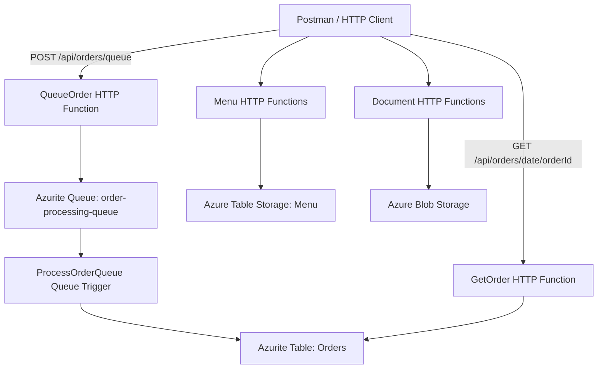

# CoffeeNChill — Azure Functions Order Processing

**CLDV6212 | Assignment — Part 2: Queue Triggers & Docker Compose Orchestration**

CoffeeNChill is a serverless coffee-ordering backend built with **C#**, **.NET 8**, and **Azure Functions v4 (isolated worker)**. Part 2 extends the existing menu and staff-document functionality with **asynchronous order processing**, using **Azure Queue Storage** and **Azure Table Storage**. The application and local storage emulator run in containers orchestrated by **Docker Compose**.

> **Demonstration environment:** Local Docker Desktop on Windows, using Azurite instead of a live Azure Storage account.

## Features

- Menu management using Azure Table Storage (carried over from Part 1).
- Staff-document upload, listing, and download using Azure Blob Storage (carried over from Part 1).
- HTTP endpoint for submitting customer orders to a storage queue.
- Queue-triggered background processing that records and updates orders in Azure Table Storage.
- Order status progression: **Received → Preparing → Ready → Collected**.
- HTTP endpoint for retrieving an order by date and order ID.
- Docker image distribution via Docker Hub and multi-container orchestration via Docker Compose.
- Postman collection for testing API endpoints and validation behaviour.

## Architecture



1. A client submits an order to the `QueueOrder` HTTP function.
2. The function validates the payload, serialises it as JSON, and sends it to `order-processing-queue`.
3. The `ProcessOrderQueue` Azure Function receives the message asynchronously.
4. The order is inserted or updated in the `Orders` table, progressing through the four statuses.
5. The client retrieves the latest stored status using the `GetOrder` HTTP function.

The short delays between statuses are **for demonstration only**. In a production application, transitions should correspond to actual preparation and collection events.

## Technology stack

| Component | Technology |
| --- | --- |
| Language | C# |
| Framework | .NET 8 |
| Serverless runtime | Azure Functions v4, isolated worker |
| Queue | Azure Queue Storage (Azurite locally) |
| Persistent order records | Azure Table Storage (Azurite locally) |
| Documents | Azure Blob Storage (Azurite locally) |
| Containers | Docker / Docker Desktop |
| Orchestration | Docker Compose |
| Image registry | Docker Hub |
| API testing | Postman |

## Repository structure

```text
CoffeeNChill/
├── CofeeNChill.Functions/
│   ├── Functions/
│   │   ├── MenuFunctions.cs
│   │   ├── DocumentFunctions.cs
│   │   └── OrderFunctions.cs
│   ├── Models/
│   │   ├── MenuItem.cs
│   │   └── QueuedOrder.cs
│   ├── Program.cs
│   ├── host.json
│   ├── Dockerfile
│   └── CofeeNChill.Functions.csproj
├── docs/
│   └── CofeNChill.postman_collection.json
├── docker-compose.yml
├── .env.example
└── README.md
```

## Prerequisites

- Docker Desktop with Linux containers enabled and Docker Compose installed.
- .NET SDK compatible with the project's .NET 8 target (used for local builds).
- A Docker Hub account to publish the Functions image.
- Postman for API testing.
- Internet access for downloading images and NuGet packages during the initial build.

## Local setup

### 1. Clone the repository

```powershell
git clone <YOUR_GITHUB_REPOSITORY_URL>
cd CoffeeNChill
```

Alternatively, open PowerShell in your existing `CoffeeNChill` directory.

### 2. Build the application

```powershell
dotnet build .\CofeeNChill.Functions\CofeeNChill.Functions.csproj
```

**Observed during testing:** The project built successfully with zero errors and one existing nullable-reference warning in `MenuFunctions.cs`.

### 3. Configure environment variables

```powershell
Copy-Item .env.example .env
notepad .env
```

Set `DOCKERHUB_USERNAME` to your Docker Hub username.

Validate configuration:

```powershell
docker compose config --quiet
```

### 4. Build and publish the Docker image

From the repository root:

```powershell
docker build -t st10448051/coffeenchill-functions:v2.0 .\CofeeNChill.Functions
docker login -u st10448051
docker push st10448051/coffeenchill-functions:v2.0
```

Docker Hub image: `st10448051/coffeenchill-functions:v2.0`

### 5. Start the containers

```powershell
docker compose pull
docker compose up -d --no-build
docker compose ps
```

The services are:

| Service | Host address / port | Purpose |
| --- | --- | --- |
| Azure Functions | `http://localhost:8080` | API and background processing |
| Azurite Blob | `localhost:10000` | Blob storage emulator |
| Azurite Queue | `localhost:10001` | Queue storage emulator |
| Azurite Table | `localhost:10002` | Table storage emulator |

Check logs:

```powershell
docker compose logs --tail=100 functions
docker compose logs --tail=100 azurite
```

Stop the services without deleting stored data:

```powershell
docker compose down
```

**Warning:** `docker compose down -v` deletes the named Azurite data volume and its locally stored data.

## API reference

All HTTP endpoints use the base URL `http://localhost:8080/api` when running through the supplied Docker Compose port mapping.

### Part 2 — Orders

| Method | Route | Purpose |
| --- | --- | --- |
| `POST` | `/orders/queue` | Validate and enqueue a new order |
| `GET` | `/orders/{date}/{orderId}` | Retrieve a processed order from the `Orders` table |

**Submit an order**

```http
POST http://localhost:8080/api/orders/queue
Content-Type: application/json
```

```json
{
  "OrderId": "ORD-2026-8801",
  "CustomerName": "Jane Smith",
  "SelectedItemSKUs": ["COF-001", "PAS-104"],
  "TotalPrice": 65.00,
  "OrderTimestamp": "2026-10-12T10:15:00Z"
}
```

Successful response (expected HTTP **202 Accepted**):

```json
{
  "OrderId": "ORD-2026-8801",
  "Message": "Order queued for processing"
}
```

Validation rejects missing order IDs, customer names, item SKUs, nonpositive totals, missing timestamps, and malformed JSON. The intended response is HTTP **400 Bad Request**. Storage failures should return **503 Service Unavailable**.

**Retrieve an order**

```http
GET http://localhost:8080/api/orders/2026-10-12/ORD-2026-8801
```

The `date` path parameter is the UTC date of the order timestamp, formatted as `yyyy-MM-dd`. It is the table's `PartitionKey`; the order ID is the `RowKey`. If no matching record exists, the endpoint returns HTTP **404 Not Found**.

### Part 1 — Existing endpoints

| Function | Route |
| --- | --- |
| Menu operations | `/api/menu` |
| Filter menu by category | `/api/menu/category/{category}` |
| Update or delete menu item | `/api/menu/{category}/{id}` |
| Upload staff document | `/api/documents/upload` |
| List staff documents | `/api/documents` |
| Download staff document | `/api/documents/download/{fileName}` |

Methods and request formats for these endpoints are defined in the existing Part 1 source and Postman collection.

## Queue and table design

- **Queue:** `order-processing-queue`
- **Queue-triggered function:** `ProcessOrderQueue`
- **Table:** `Orders`
- **PartitionKey:** order timestamp in UTC as `yyyy-MM-dd`
- **RowKey:** `OrderId`
- **Stored properties:** `CustomerName`, `SelectedItemSKUs` (JSON string), `TotalPrice`, `OrderTimestamp`, `Status`

The processor initially writes `Received`, then updates the same entity to `Preparing`, `Ready`, and finally `Collected`, using short delays to make the workflow observable during the demonstration.

## Testing with Postman

1. Import the Postman collection from `docs/` into Postman. If using the separately supplied Part 2 collection, copy it into `docs/` before submission.
2. Set the base URL to `http://localhost:8080`.
3. Submit a valid order with `POST /api/orders/queue`.
4. Wait for asynchronous processing (approximately 10–15 seconds under normal local conditions).
5. Retrieve it with `GET /api/orders/{date}/{orderId}`.
6. Test malformed or invalid order payloads and a nonexistent order ID.
7. Submit multiple distinct orders and verify each can be retrieved.

Use Azure Storage Explorer, connected to the local Azurite emulator, to inspect `order-processing-queue` and the `Orders` table. The queue may be empty after messages are consumed successfully.

### Verified local test

The following test was performed successfully on **12 October 2026**:

| Field | Observed value |
| --- | --- |
| Order ID | `ORD-2026-8801` |
| Customer | Jane Smith |
| SKUs | `COF-001`, `PAS-104` |
| Total | `65.00` |
| PartitionKey | `2026-10-12` |
| RowKey | `ORD-2026-8801` |
| Final Status | **Collected** |

The order submission returned `Order queued for processing`. A subsequent GET request returned the stored entity from the `Orders` table with `Status: Collected`. This verifies the end-to-end outcome; screenshots or logs of each intermediate status should be added to demonstrate the full transition sequence.

### Evidence for assessment

- [ ] Successful Docker Compose services (`docker compose ps`)
- [ ] Successful Docker Hub image push / repository page
- [ ] Postman successful order submission
- [ ] Postman retrieval showing `Collected`
- [ ] Postman validation and missing-order tests
- [ ] Azure Storage Explorer showing `Orders` table
- [ ] Queue-trigger processing logs or intermediate statuses

## Troubleshooting

| Problem | Suggested action |
| --- | --- |
| `dotnet build` cannot find a project | Run from `CofeeNChill.Functions` or specify the `.csproj` path. |
| Missing Compose variables | Create `.env` from `.env.example` and populate required values. |
| Azure Functions container exits | Check `docker compose ps -a`, `docker compose logs functions`, and Docker inspect state. |
| Azurite connection refused | Ensure the connection string uses the service name `azurite` within the Docker network. |
| `GET /api/orders/{orderId}` returns 404 | Include the date: `/api/orders/{date}/{orderId}`. |
| Order not found immediately after submission | Wait for asynchronous queue processing, then retry. |
| Browser GET on `/api/orders/queue` returns 404 | This endpoint accepts POST, not GET. |
| Changed code does not appear in container | Rebuild, push the updated image, pull it, and recreate the service. |

The Compose service may use `restart: unless-stopped` to recover from unexpected exits. This does not replace diagnosing the root cause of any repeated restarts.

## Changelog

### Part 1 — Initial application

- Added menu-management HTTP Azure Functions backed by Table Storage.
- Added staff-document HTTP Azure Functions backed by Blob Storage.
- Added initial project and API test collection.

### Part 2 — Queue processing and orchestration

- Added `QueuedOrder` model and order validation.
- Added `QueueOrder` HTTP function for asynchronous submission.
- Added `ProcessOrderQueue` storage queue trigger.
- Added `Orders` table with four-stage order status progression.
- Added `GetOrder` HTTP function for order lookup.
- Added Azurite and Functions services using Docker Compose.
- Added Docker Hub image tagging and publication workflow.
- Extended Postman testing and documentation.
- Corrected `WriteAsJsonAsync` usage to resolve compilation errors.

## Author and links

- **Student:** ST10448051
- **Module:** CLDV6212
- **GitHub repository:** [ADD REPOSITORY URL]
- **Docker Hub:** https://hub.docker.com/r/st10448051/coffeenchill-functions

---

*CoffeeNChill — asynchronous coffee ordering with Azure Functions, Azure Storage, and Docker.*
